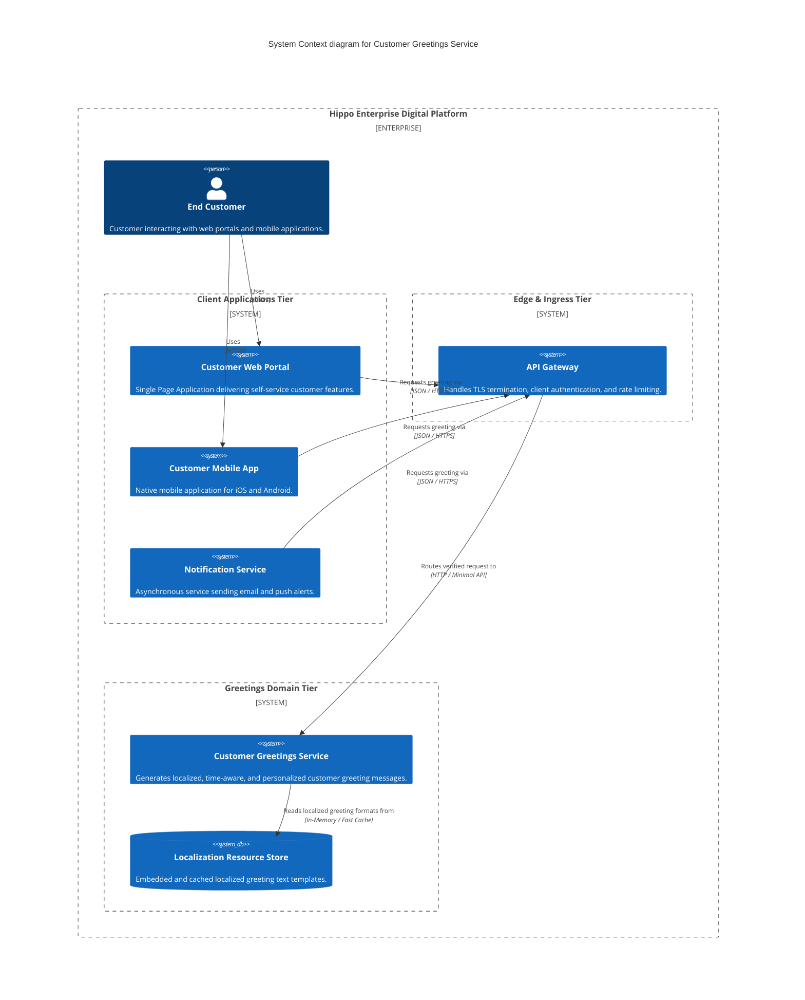

# Customer Greetings Service — Architecture

## System Diagram



## Tech Stack

- **Runtime & Language:** .NET 9 LTS, C# 13
- **Framework:** ASP.NET Core Minimal APIs
- **API Documentation & Validation:** OpenAPI 3.0, Scalar / Swagger UI, FluentValidation
- **Dependency Injection & Host:** Standard Microsoft.Extensions.DependencyInjection and Generic Host
- **Time Abstraction:** Microsoft .NET `TimeProvider`
- **Testing Frameworks:** xUnit, FluentAssertions, `Microsoft.AspNetCore.Mvc.Testing`
- **Containerization:** Linux Container Images (Docker, `mcr.microsoft.com/dotnet/aspnet:9.0-noble-chiseled`)
- **CI/CD:** GitHub Actions

## Layers

The codebase implements a clean, layered architecture with three primary projects:

1. **Presentation Layer (`CustomerGreetings.Api`):**
   - Implements ASP.NET Core Minimal API route endpoints.
   - Handles HTTP request serialization, parameter binding, and response generation.
   - Enforces RFC 7807 `ProblemDetails` error formats and exposes OpenAPI contracts.

2. **Core / Domain Layer (`CustomerGreetings.Core`):**
   - Contains pure business logic, models, enumerations, and validation rules.
   - Defines greeting calculators, time-of-day classifiers, and formatting rules.
   - Free from external infrastructure and HTTP transport dependencies.

3. **Infrastructure Layer (`CustomerGreetings.Infrastructure`):**
   - Implements resource localization file readers and in-memory template caches.
   - Provides concrete adapters for external services and system time providers.

## Key Patterns

- **Minimal APIs Pattern:** Compact, high-performance endpoint mappings grouped by feature slice.
- **Endpoint Filter Validation Pattern:** Intercepts requests using generic filters to execute FluentValidation rules and format RFC 7807 responses.
- **Adapter Pattern:** Uses `TimeProvider` abstraction to isolate non-deterministic clock evaluations for deterministic unit testing.
- **Strategy Pattern:** Selects tone-of-voice and language formatting strategies dynamically from request attributes.
- **Result / ProblemDetails Pattern:** Returns explicit typed results or standard RFC 7807 error models without relying on unhandled exceptions for control flow.

## Source code layout

```text
/
├── .github/
│   └── workflows/
│       └── ci.yml
├── .memory/
├── src/
│   ├── CustomerGreetings.Api/
│   │   ├── Endpoints/
│   │   │   ├── GreetingEndpoints.cs
│   │   │   └── HelloWorldEndpoints.cs
│   │   ├── Filters/
│   │   │   └── ValidationFilter.cs
│   │   ├── Extensions/
│   │   │   └── ServiceCollectionExtensions.cs
│   │   ├── Program.cs
│   │   └── appsettings.json
│   ├── CustomerGreetings.Core/
│   │   ├── Enums/
│   │   │   ├── GreetingTone.cs
│   │   │   └── TimeOfDay.cs
│   │   ├── Models/
│   │   │   ├── GreetingRequest.cs
│   │   │   ├── GreetingResponse.cs
│   │   │   ├── HelloWorldRequest.cs
│   │   │   └── HelloWorldResponse.cs
│   │   ├── Services/
│   │   │   ├── IGreetingService.cs
│   │   │   ├── GreetingService.cs
│   │   │   ├── IHelloWorldService.cs
│   │   │   └── HelloWorldService.cs
│   │   └── Validators/
│   │       ├── GreetingRequestValidator.cs
│   │       └── HelloWorldRequestValidator.cs
│   └── CustomerGreetings.Infrastructure/
│       ├── Localization/
│       │   ├── ILocalizationProvider.cs
│       │   └── EmbeddedResourceLocalizationProvider.cs
│       └── Resources/
│           ├── Greetings.en-GB.json
│           ├── Greetings.es-ES.json
│           ├── Greetings.fr-FR.json
│           └── Greetings.de-DE.json
└── tests/
    ├── CustomerGreetings.Core.UnitTests/
    │   ├── Services/
    │   │   └── HelloWorldServiceTests.cs
    │   └── Validators/
    │       └── HelloWorldRequestValidatorTests.cs
    └── CustomerGreetings.Api.IntegrationTests/
        ├── Endpoints/
        │   └── HelloWorldEndpointTests.cs
        └── Filters/
            └── ValidationFilterTests.cs
```

## Data Flow

### Hello World Verification Flow

1. An upstream client sends an HTTP `GET /api/v1/hello` request with an optional `name` query parameter.
2. The `ValidationFilter<HelloWorldRequest>` executes `HelloWorldRequestValidator`.
3. If validation fails, the filter returns an immediate `400 Bad Request` formatted as RFC 7807 `ProblemDetails`.
4. The endpoint handler passes the validated request to `IHelloWorldService`.
5. The service constructs the greeting and queries `TimeProvider` for the current UTC timestamp.
6. The endpoint returns a `200 OK` response with `HelloWorldResponse` in camelCase JSON.

### Contextual Customer Greetings Flow
2. The `CustomerGreetings.Api` layer binds parameters to a strongly-typed `GreetingRequest` object.
3. The request runs through `FluentValidation`. Invalid fields return an immediate `400 Bad Request` formatted as RFC 7807 `ProblemDetails`.
4. The endpoint invokes `IGreetingService` within `CustomerGreetings.Core`.
5. The service determines the appropriate `TimeOfDay` using `TimeProvider` and the supplied customer timestamp/offset.
6. The service queries `ILocalizationProvider` in `CustomerGreetings.Infrastructure` to retrieve the localized template matching language and tone.
7. The service interpolates customer name and honorifics into the selected template.
8. The endpoint returns a `200 OK` response containing `GreetingResponse` payload with metadata (locale, tone, generated timestamp).

## Cross-Cutting Concerns

- **Observability:** Structured logging with OpenTelemetry and `ILogger`. Emits trace context headers (`traceparent`).
- **Health Checks:** Built-in endpoints at `/healthz/live` and `/healthz/ready`.
- **Error Handling:** Centralized exception handling middleware mapped to RFC 7807 `ProblemDetails`.
- **Security:** Ingress rate limiting and TLS handled by upstream API Gateway; internal mutual TLS or bearer validation; strictly no PII storage.

## ADRs

<!-- adr-table:start -->
| ID | Title | Status | Date |
|----|-------|--------|------|
| [ADR-0001](decisions/ADR-0001-use-dotnet-minimal-apis.md) | Use .NET 9 ASP.NET Core Minimal APIs | accepted | 2026-03-30 |
| [ADR-0002](decisions/ADR-0002-layered-vertical-slice-architecture.md) | Adopt Layered Architecture with Vertical Feature Slices | accepted | 2026-03-30 |
| [ADR-0003](decisions/ADR-0003-endpoint-filter-validation-pattern.md) | Endpoint Filter Validation Pattern for Minimal APIs | accepted | 2026-03-30 |
<!-- adr-table:end -->

## Assumptions

<!-- assumption-list:start -->
- [ASSUME-0001](assumptions/ASSUME-0001-stateless-greeting-architecture.md): Stateless Customer Context Ingestion (unresolved)
- [ASSUME-0002](assumptions/ASSUME-0002-upstream-gateway-auth.md): Upstream Gateway Handles Authentication and Ingress Security (unresolved)
- [ASSUME-0003](assumptions/ASSUME-0003-deterministic-time-testing.md): Deterministic Time Simulation Using FakeTimeProvider (validated)
- [ASSUME-0004](assumptions/ASSUME-0004-hello-world-developer-onboarding.md): Hello-World Endpoint Accelerates Client Onboarding and Verification (unresolved)
- [ASSUME-0005](assumptions/ASSUME-0005-hello-world-stateless-payload.md): Hello-World Greeting Uses Standard Minimal Payload (validated)
- [ASSUME-0006](assumptions/ASSUME-0006-hello-world-anonymous-access.md): Hello-World Endpoint Permits Anonymous Access (validated)
- [ASSUME-0007](assumptions/ASSUME-0007-hello-world-english-only-phase1.md): Hello-World Endpoint Operates Without Internationalization (validated)
<!-- assumption-list:end -->

The save_adr and save_assumption tools fill these lists. Do not edit between the markers.
